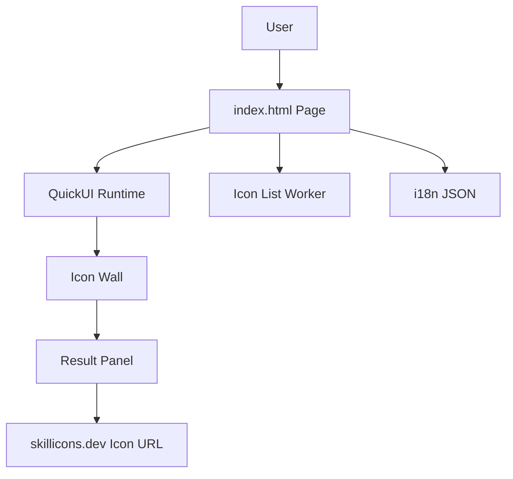

Last updated: 2026-10-25

> [!NOTE]
> This README was generated by [SKILL](https://github.com/agenvoy/skill-readme-generate), get the ZH version from [here](./doc/README.zh.md).

***

<strong>PICK, SORT, AND COPY YOUR SKILL ICONS IN SECONDS!</strong>

***

> A JavaScript web tool with click-to-pick Skill Icons, drag-and-drop ordering, and one-click link copying

## Table of Contents

- [Features](#features)
- [Architecture](#architecture)
- [License](#license)
- [Author](#author)

## Features

> `git clone https://github.com/pardnchiu/SkilliconsPicker.git` · [Documentation](./doc/doc.md)

- **Live Icon List** — The page loads the latest Skill Icons list from a remote endpoint on open, so new icons appear without code changes.
- **Click to Compose** — One click on the full icon wall adds or removes an icon, and the result panel mirrors the current set.
- **Drag to Sort, Double-Click to Remove** — Drag icons to reorder them and double-click to drop one, so the output order matches what you see.
- **One-Click Copy or Open** — The tool builds a skillicons.dev icon URL in the current order, ready to copy or preview in a new tab.
- **Bilingual Auto Switch** — The interface follows the browser language and accepts a URL parameter to switch manually.

## Architecture

> [Full Architecture](./doc/architecture.md)

## License

This project is licensed under the [MIT LICENSE](LICENSE).

## Author

Just [open an issue](https://github.com/pardnchiu/SkilliconsPicker/issues/new) to share an idea.

***

©️ 2025 [邱敬幃 Pardn Chiu](https://www.linkedin.com/in/pardnchiu)
