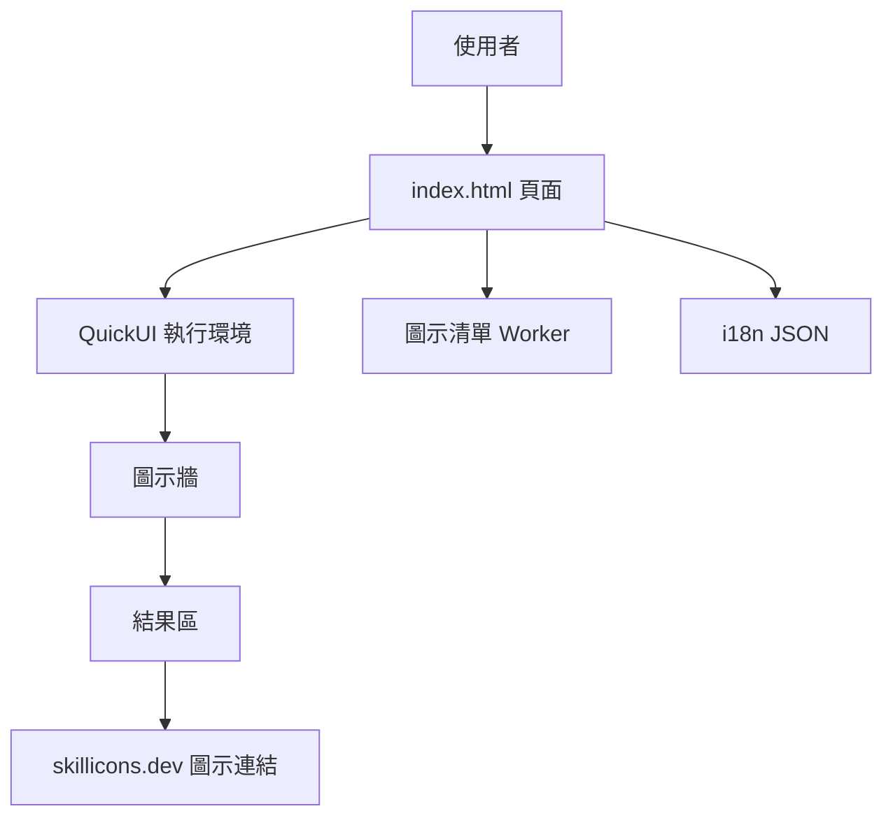

最後更新：2026-10-25

> [!NOTE]
> 此 README 由 [SKILL](https://github.com/agenvoy/skill-readme-generate) 生成，英文版請參閱 [這裡](../README.md)。

***

<strong>PICK, SORT, AND COPY YOUR SKILL ICONS IN SECONDS!</strong>

***

> JavaScript 網頁工具，具備點選挑選 Skill Icons、拖放排序與一鍵複製連結

## 目錄

- [功能特點](#功能特點)
- [架構](#架構)
- [授權](#授權)
- [Author](#author)

## 功能特點

> `git clone https://github.com/pardnchiu/SkilliconsPicker.git` · [完整文件](./doc.zh.md)

- **即時同步圖示清單** — 開頁時從遠端端點載入最新的 Skill Icons 清單，新圖示上線不必改程式碼。
- **點選即組合** — 在完整圖示牆上點一下即加入或移出選擇，結果區同步顯示目前組合。
- **拖放排序與雙擊移除** — 直接拖曳調整圖示順序、雙擊移除單一圖示，輸出順序即所見順序。
- **一鍵複製或開啟連結** — 依目前順序組出 skillicons.dev 圖示網址，可直接複製或在新分頁預覽。
- **中英雙語自動切換** — 依瀏覽器語言決定介面語系，並可透過網址參數手動切換。

## 架構

> [完整架構](./architecture.zh.md)

## 授權

本專案採用 [MIT LICENSE](../LICENSE)。

## Author

Just [open an issue](https://github.com/pardnchiu/SkilliconsPicker/issues/new) to share an idea.

***

©️ 2025 [邱敬幃 Pardn Chiu](https://www.linkedin.com/in/pardnchiu)
