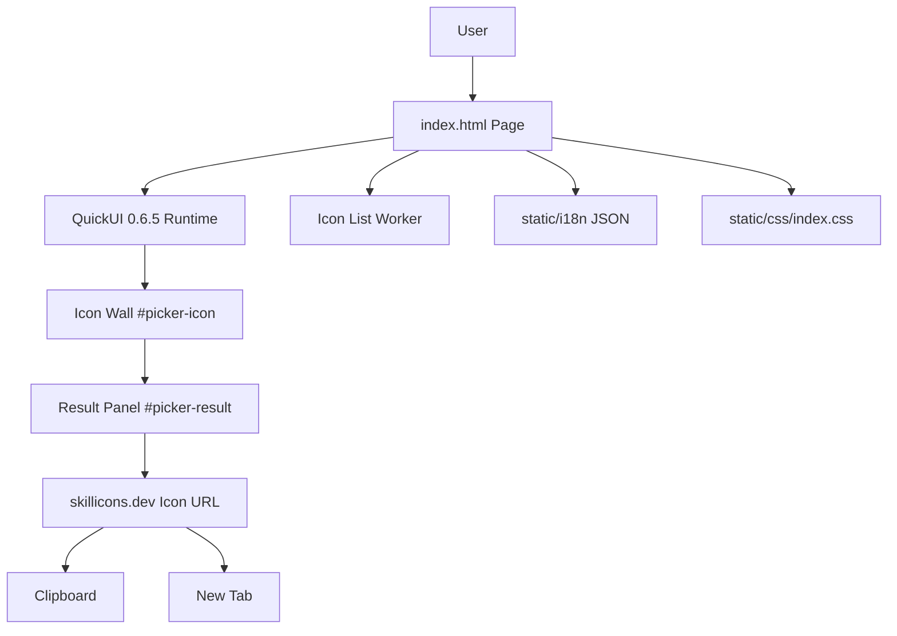
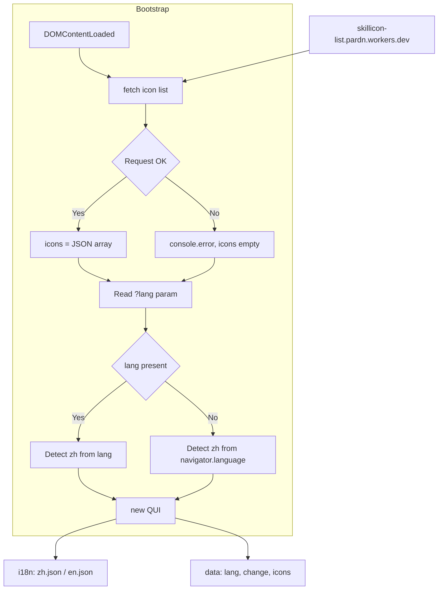
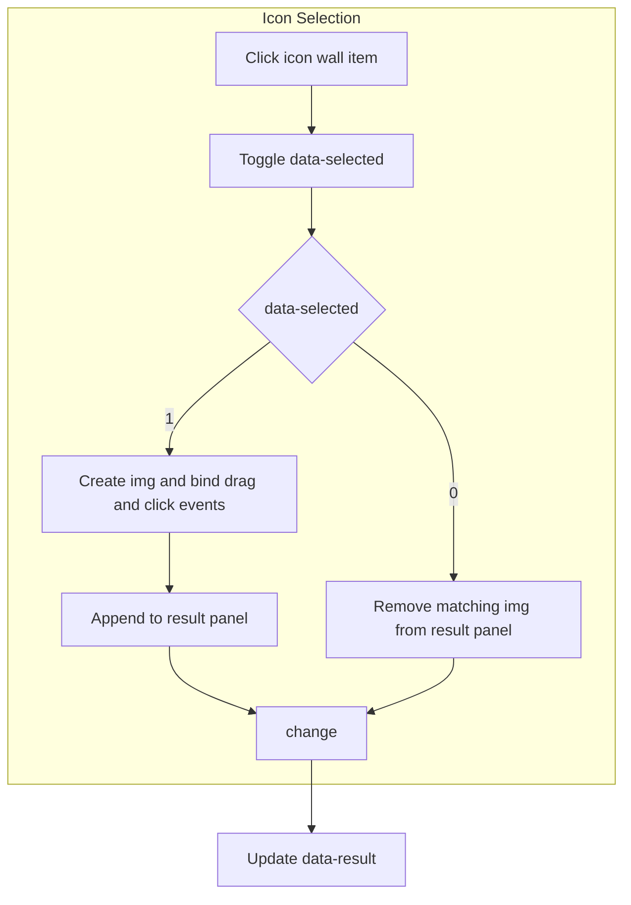
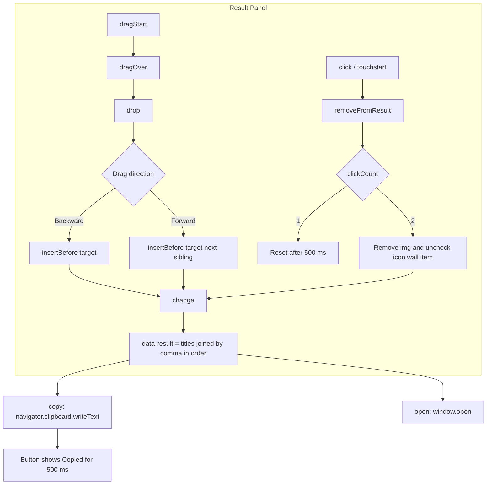
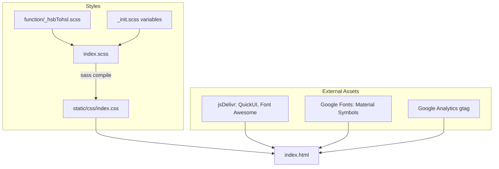
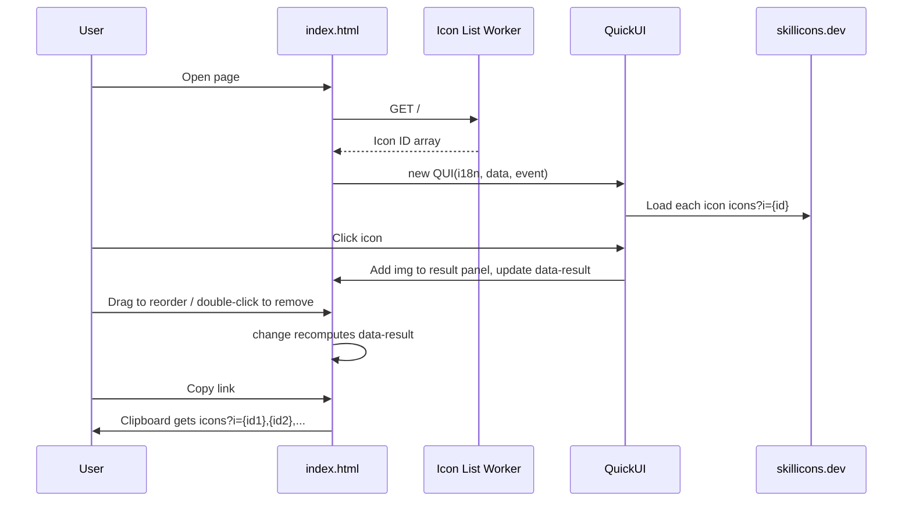
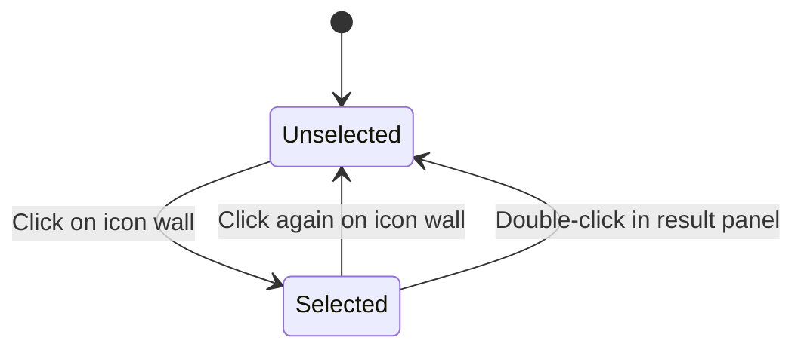
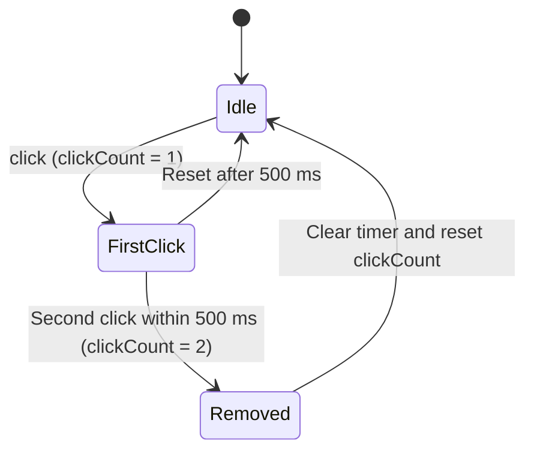

# SkilliconsPicker - Architecture

Last updated: 2026-10-25

> Back to [README](../README.md)

## Overview

## Module: Bootstrap

On `DOMContentLoaded`, the page fetches the icon list, resolves the language, and creates the QuickUI instance.

## Module: Icon Selection

The icon wall renders each icon via `:for`; a click toggles `data-selected` and syncs the result panel.

## Module: Result Panel

The result panel handles ordering, removal, and output.

## Module: Styles and Assets

## Data Flow

## State Machine

Selection state of a single icon wall item:

Double-click detection in the result panel:

***

©️ 2025 [邱敬幃 Pardn Chiu](https://www.linkedin.com/in/pardnchiu)
