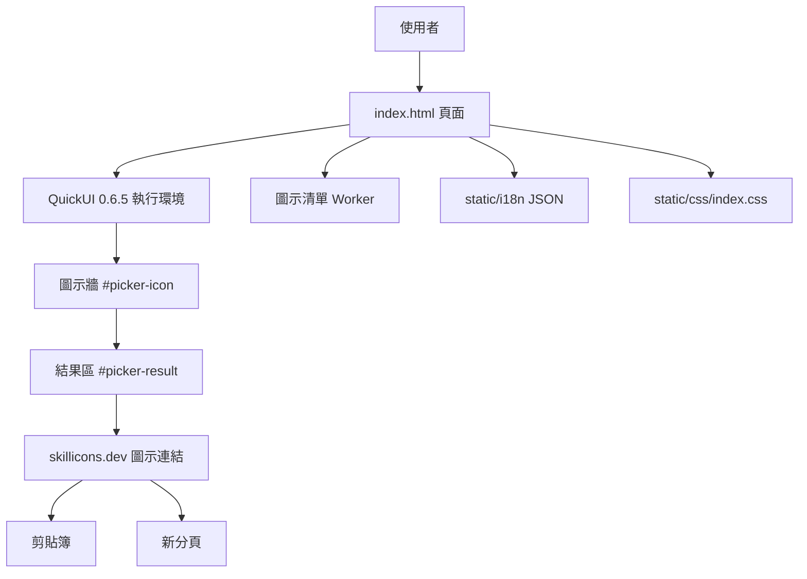
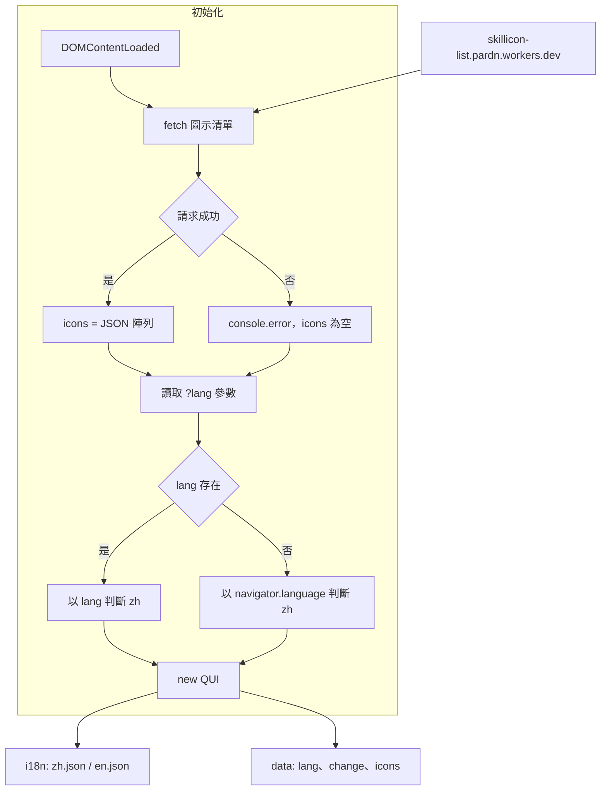
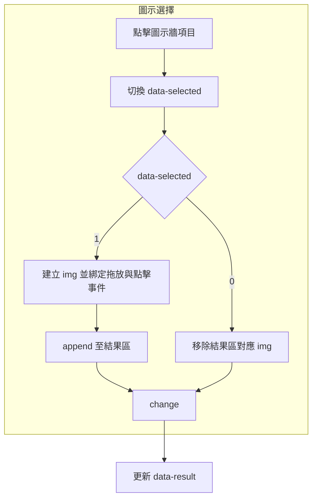
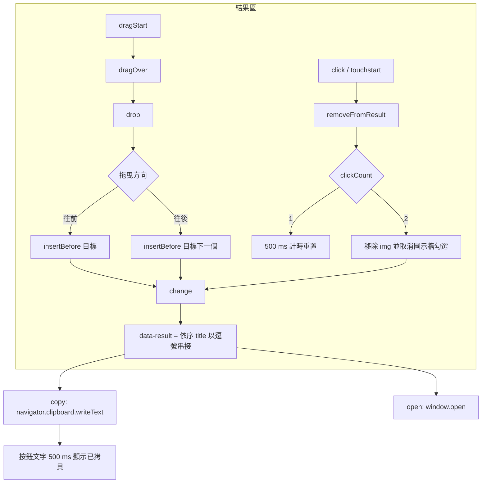
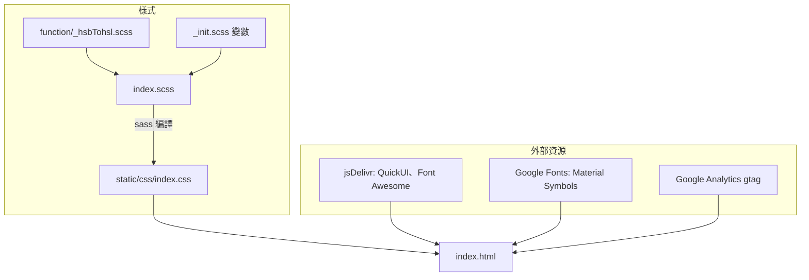
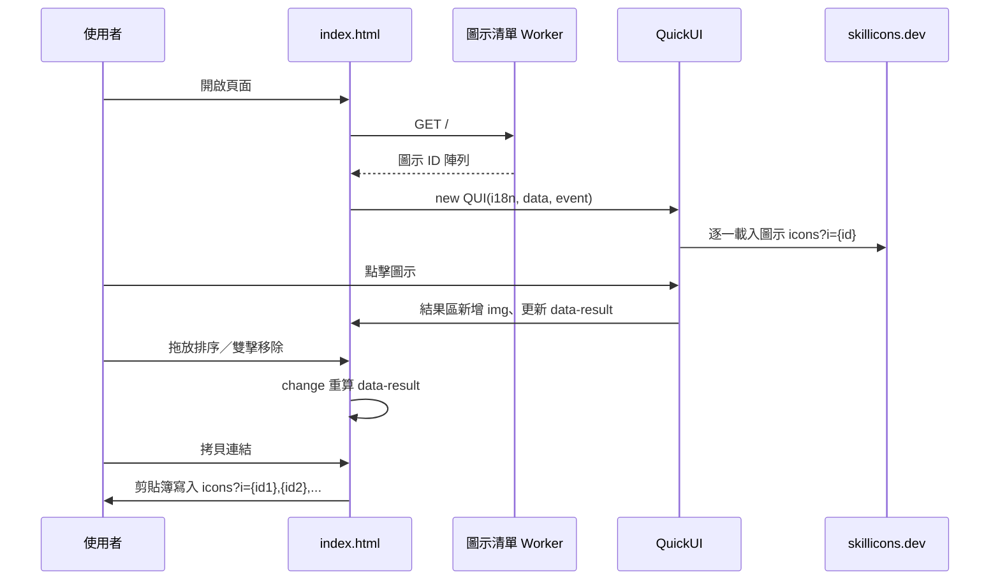
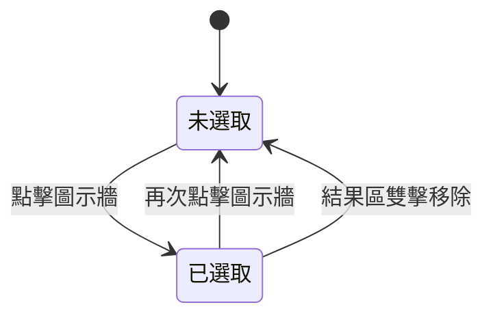
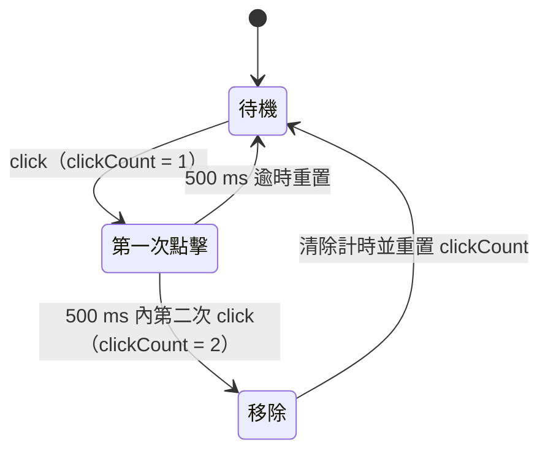

# SkilliconsPicker - 架構

最後更新：2026-10-25

> 返回 [README](./README.zh.md)

## 概覽

## Module: 初始化

`DOMContentLoaded` 時取得圖示清單、判斷語系並建立 QuickUI 實例。

## Module: 圖示選擇

圖示牆以 `:for` 渲染每個圖示，點擊時切換 `data-selected` 並同步結果區。

## Module: 結果區操作

結果區負責排序、移除與輸出。

## Module: 樣式與資源

## 資料流

## 狀態機

圖示牆單一項目的選取狀態：

結果區的雙擊判定：

***

©️ 2025 [邱敬幃 Pardn Chiu](https://www.linkedin.com/in/pardnchiu)
